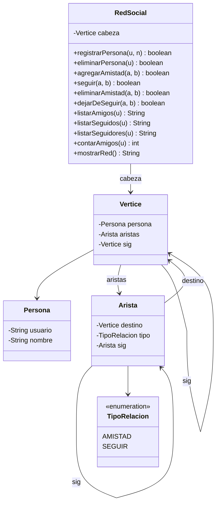
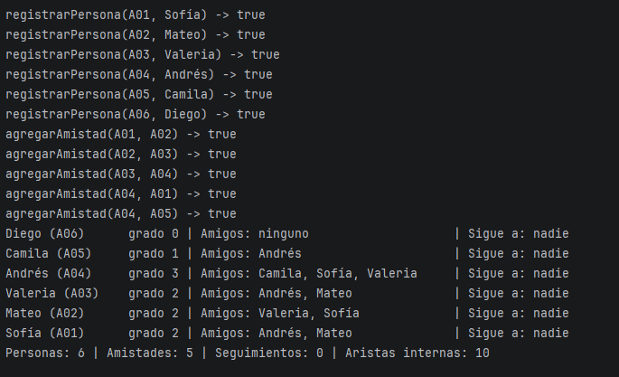
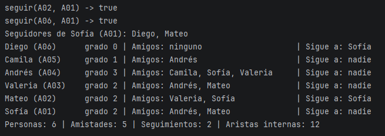
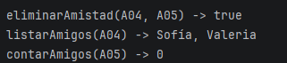
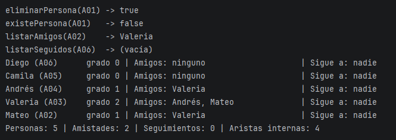
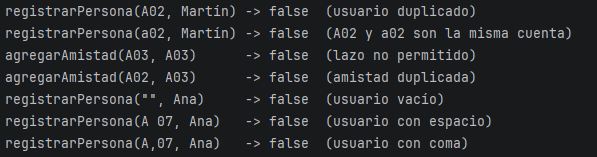
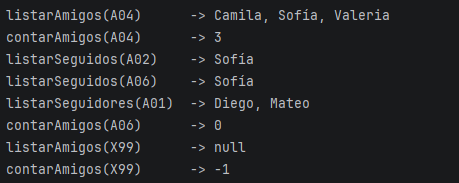
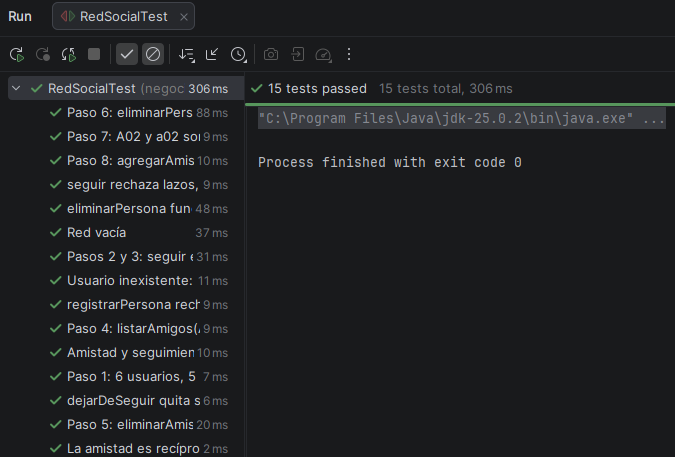

# APE 4 · Fase 2: Conexión Ambato como red social dinámica

**Universidad Técnica de Ambato · FISEI · Carrera de Software**
**Asignatura:** Estructura de Datos · **Nivel:** Tercero B · **Docente:** Ing. José Caiza, Mg.
**Autor:** Chico Yunda Juan Carlos · **Ciclo:** julio a diciembre 2026

---

## Qué hace

La Fase 1 modeló «Conexión Ambato» como un grafo estático: 6 usuarios y 5 amistades recíprocas. En esta Fase 2 esa red pasa a ser **dinámica**: se representa con una **multilista** (lista de vértices donde cada vértice tiene su propia lista de aristas), construida con nodos propios. Se agregan operaciones para registrar y eliminar personas y un nuevo tipo de relación **dirigida**: `SEGUIR`.

| Relación | Tipo de arista | Cómo se almacena |
|---|---|---|
| `AMISTAD` | no dirigida (recíproca) | dos aristas: A → B y B → A |
| `SEGUIR` | dirigida | una sola arista: quien sigue → seguido |

## Modelo



Esquema lógico después de registrar A01 a A06 (inserción al inicio):

```
cabeza → [Diego] → [Camila] → [Andrés] → [Valeria] → [Mateo] → [Sofía] → null
              │          │          │
              ▼          ▼          ▼
            (aristas AMISTAD y SEGUIR de cada vértice)
```

## Restricciones respetadas

- Solo nodos propios (`Vertice`, `Arista`): **sin** `HashMap`, `HashSet`, `ArrayList` ni `LinkedList`.
- Sin lazos (A con A) ni relaciones duplicadas del mismo tipo.
- El usuario se normaliza (`trim` + minúsculas): `A01`, `a01` y ` A01 ` son la misma cuenta.
- Se rechaza el usuario vacío, nulo, con espacios o con comas, y el nombre vacío.
- Antes de desenlazar a una persona se eliminan **todas las aristas entrantes** hacia ella.

## Estructura del proyecto

```
APE4-Fase2-Grafos-ChicoJuan/
├── pom.xml
├── src/main/java/
│   ├── modelo/    TipoRelacion, Persona, Vertice, Arista
│   ├── negocio/   RedSocial
│   └── app/       Main (menú) y Demostracion (secuencia de comprobación directa)
├── src/test/java/
│   └── negocio/   RedSocialTest (JUnit 5, 15 pruebas)
├── entrega/
│   └── APE4Fase2ChicoJuan.java   (todas las clases en un solo archivo, el que se sube a Moodle)
└── docs/
    ├── capturas/
    └── Informe_APE4_Fase2_ChicoJuan.pdf
```

## Operaciones

| Operación | Resultado | Regla |
|---|---|---|
| `registrarPersona(u, n)` | true/false | rechaza vacío, repetido, con espacios o comas |
| `eliminarPersona(u)` | true/false | elimina el vértice y todas las aristas entrantes |
| `agregarAmistad(a, b)` | true/false | dos aristas AMISTAD, sin lazos ni duplicados |
| `seguir(a, b)` | true/false | una arista dirigida SEGUIR |
| `eliminarAmistad(a, b)` | true/false | quita ambas aristas AMISTAD |
| `dejarDeSeguir(a, b)` | true/false | quita solo la arista SEGUIR |
| `listarAmigos / listarSeguidos / listarSeguidores(u)` | texto o null | null si el usuario no existe |
| `contarAmigos(u)` | entero | −1 si el usuario no existe |

Auxiliares privados: `buscar`, `existe`, `insertar`, `quitar` y `quitarHacia`.

## Cómo ejecutar

**IntelliJ IDEA:** abrir la carpeta (detecta el `pom.xml`) y ejecutar `app.Demostracion` para la secuencia de comprobación, o `app.Main` para el menú interactivo. Para las pruebas: clic derecho sobre `RedSocialTest` → *Run*.

**Archivo único (sin Maven):**

```bash
cd entrega
javac -encoding UTF-8 APE4Fase2ChicoJuan.java
java APE4Fase2ChicoJuan
```

**Consola (Maven):**

```bash
mvn test
mvn compile exec:java
```

## Resultados: secuencia de comprobación (Tabla 3)

| Paso | Acción | Esperado | Obtenido | Evidencia |
|---|---|---|---|---|
| 1 | Registrar A01 a A06 y las 5 amistades | 6 usuarios, 5 amistades, grados 2,2,2,3,1,0 | ✅ 6 personas, 5 amistades, 10 aristas internas; grados 2,2,2,3,1,0 | [Anexo 1](docs/capturas/anexo1_registro_y_mostrarRed.png) |
| 2 | `seguir(A02, A01)` | Mateo aparece entre los seguidores de Sofía | ✅ true; seguidores de Sofía: Diego, Mateo | [Anexo 2](docs/capturas/anexo2_seguimientos.png) |
| 3 | `seguir(A06, A01)` | Diego sigue a Sofía aunque no tenga amigos | ✅ true; Diego: grado 0, sigue a Sofía | [Anexo 2](docs/capturas/anexo2_seguimientos.png) |
| 4 | `listarAmigos(A04)` | Valeria, Sofía y Camila (orden según inserción) | ✅ Camila, Sofía, Valeria | [Anexo 4](docs/capturas/anexo4_listados.png) |
| 5 | `eliminarAmistad(A04, A05)` | Andrés pierde a Camila y viceversa | ✅ true; Andrés: Sofía, Valeria; Camila: 0 amigos | [Anexo 3](docs/capturas/anexo3a_eliminarAmistad.png) |
| 6 | `eliminarPersona(A01)` | Se borran Sofía y todas las referencias hacia ella | ✅ true; 5 personas, 2 amistades, 0 seguimientos | [Anexo 3](docs/capturas/anexo3b_eliminarPersona.png) |
| 7 | `registrarPersona(A02, otro nombre)` | false: usuario duplicado | ✅ false (también con `a02`) | [Anexo 3](docs/capturas/anexo3c_validaciones.png) |
| 8 | `agregarAmistad(A03, A03)` | false: lazo no permitido | ✅ false | [Anexo 3](docs/capturas/anexo3c_validaciones.png) |

> En el paso 4 aparecen los mismos tres amigos, pero en orden inverso. Es correcto: `insertar` coloca cada arista nueva **al inicio** de la lista, así que la última amistad registrada (Camila) se lista primero.

**Pruebas automatizadas:** 15 pruebas JUnit 5, 0 fallos ([Anexo 5](docs/capturas/anexo5_pruebas_junit.png)).

## Complejidad

| Operación | Costo | Motivo |
|---|---|---|
| buscar / registrar | O(V) | búsqueda lineal entre usuarios |
| agregarAmistad / seguir | O(V + grado) | localizar usuarios y revisar duplicados |
| eliminarAmistad / dejarDeSeguir | O(V + grado) | buscar extremos y retirar aristas |
| eliminarPersona | O(V + A) | revisar todas las aristas entrantes |
| listarAmigos / listarSeguidos | O(V + grado) | buscar y recorrer la lista propia |
| listarSeguidores | O(V + A) | revisar las aristas de toda la red |
| contarAmigos | O(V + grado) | buscar y contar amistades |
| mostrarRed | O(V + A) | recorrer vértices y aristas |

V = número de personas, A = número de aristas almacenadas (cada amistad aporta dos).

## Preguntas de la Fase 2 (versión corta)

**1. ¿Cómo se representa dinámicamente una persona y una relación?**
Cada persona es un `Vertice` que guarda su `Persona`, la referencia a su primera `Arista` y al siguiente vértice. Cada relación es una `Arista` con el vértice destino, su `TipoRelacion` y la siguiente arista. Todo se enlaza con referencias, así que la red crece o se reduce sin tamaño fijo.

**2. ¿Por qué la amistad necesita dos aristas y seguir solo una?**
La amistad es simétrica: si A es amigo de B, B es amigo de A. Como cada vértice solo recorre sus aristas **salientes**, la relación tiene que estar en las dos listas. Seguir es asimétrico (A sigue a B no implica lo contrario), por eso basta una arista de A hacia B.

**3. ¿Qué validaciones se realizan antes de registrar una relación?**
Que ambos usuarios existan (tras normalizarlos), que no sean el mismo (sin lazos) y que no exista ya una relación del mismo tipo entre ellos (sin duplicados).

**4. ¿Por qué eliminar una persona exige recorrer toda la red?**
Las aristas solo se guardan en la lista del origen. El vértice que se elimina no sabe quién lo apunta, así que hay que revisar la lista de cada vértice para quitar las aristas entrantes. Si no se hace, quedarían referencias colgando hacia un usuario borrado.

**5. ¿Por qué listarSeguidores es más costoso que listarSeguidos?**
Los seguidos están en la lista propia del usuario: O(V + grado). Los seguidores son aristas entrantes guardadas en las listas de otros, y para encontrarlos hay que recorrer toda la red: O(V + A).

**6. ¿Qué aporta la lista de adyacencia frente a una matriz?**
Usa memoria proporcional a V + A en vez de V², que en una red social dispersa es mucho menor. Además, agregar una persona no obliga a redimensionar una matriz y permite guardar varios tipos de relación entre el mismo par. Lo que se pierde es la consulta en O(1) de "¿existe A → B?", que en la lista cuesta O(grado).

## Anexos

Capturas de la ejecución real en IntelliJ IDEA (`app.Demostracion` y `RedSocialTest`). Todas están en [`docs/capturas`](docs/capturas) y el informe completo en [`docs/`](docs).

### Anexo 1 · registrarPersona y mostrarRed (paso 1)



### Anexo 2 · Amistades y seguimientos (pasos 2 y 3)



### Anexo 3 · eliminarAmistad, eliminarPersona y validaciones (pasos 5 a 8)

**Paso 5:** `eliminarAmistad(A04, A05)`



**Paso 6:** `eliminarPersona(A01)`



**Pasos 7 y 8:** validaciones



### Anexo 4 · listarAmigos, listarSeguidos, listarSeguidores y contarAmigos (paso 4)



### Anexo 5 · Pruebas automatizadas con JUnit 5


